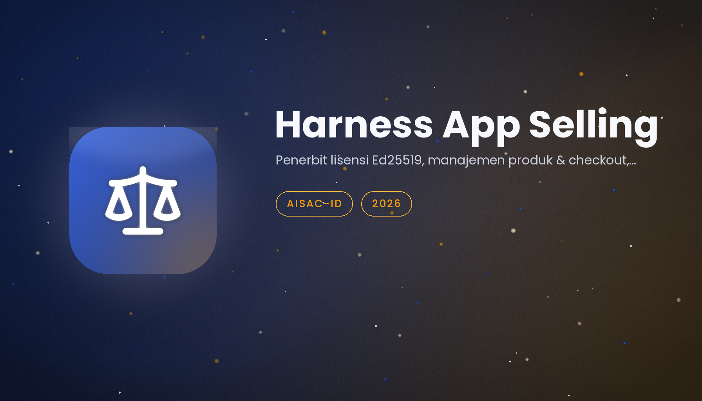
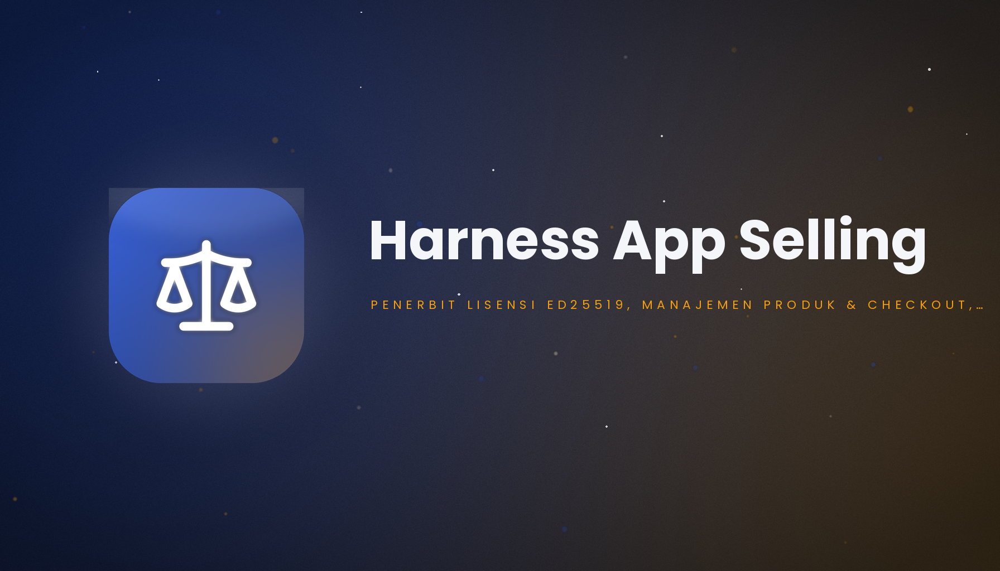
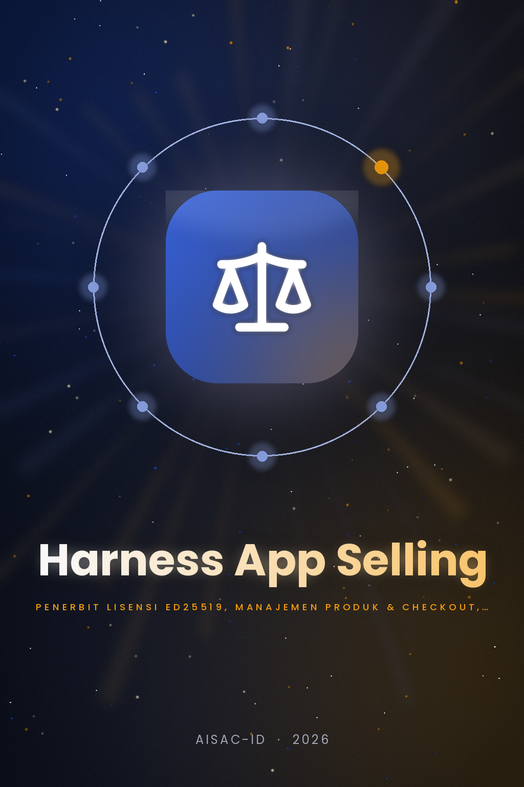
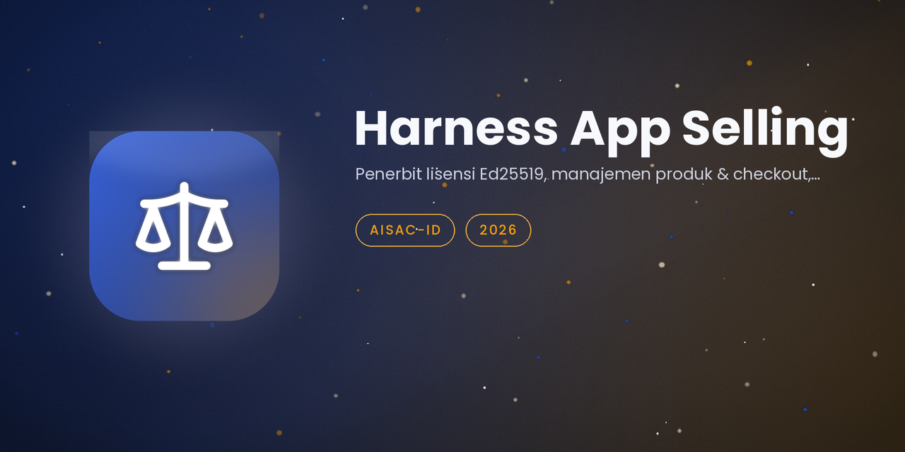
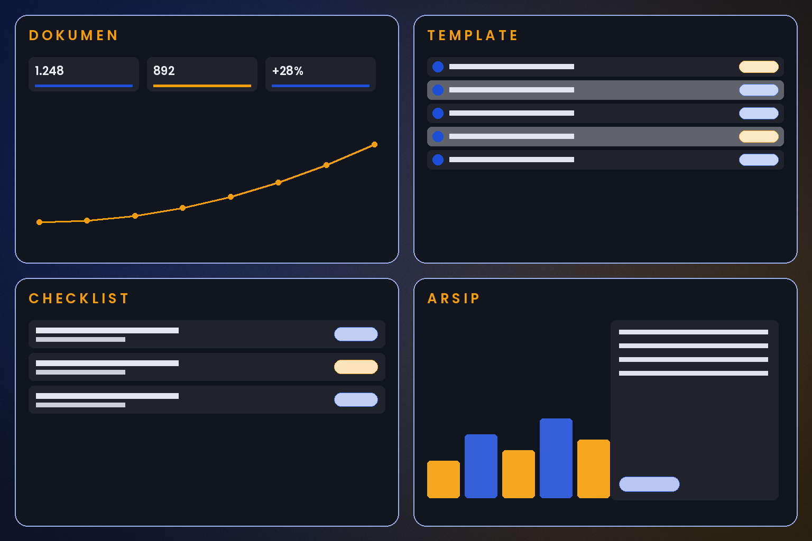
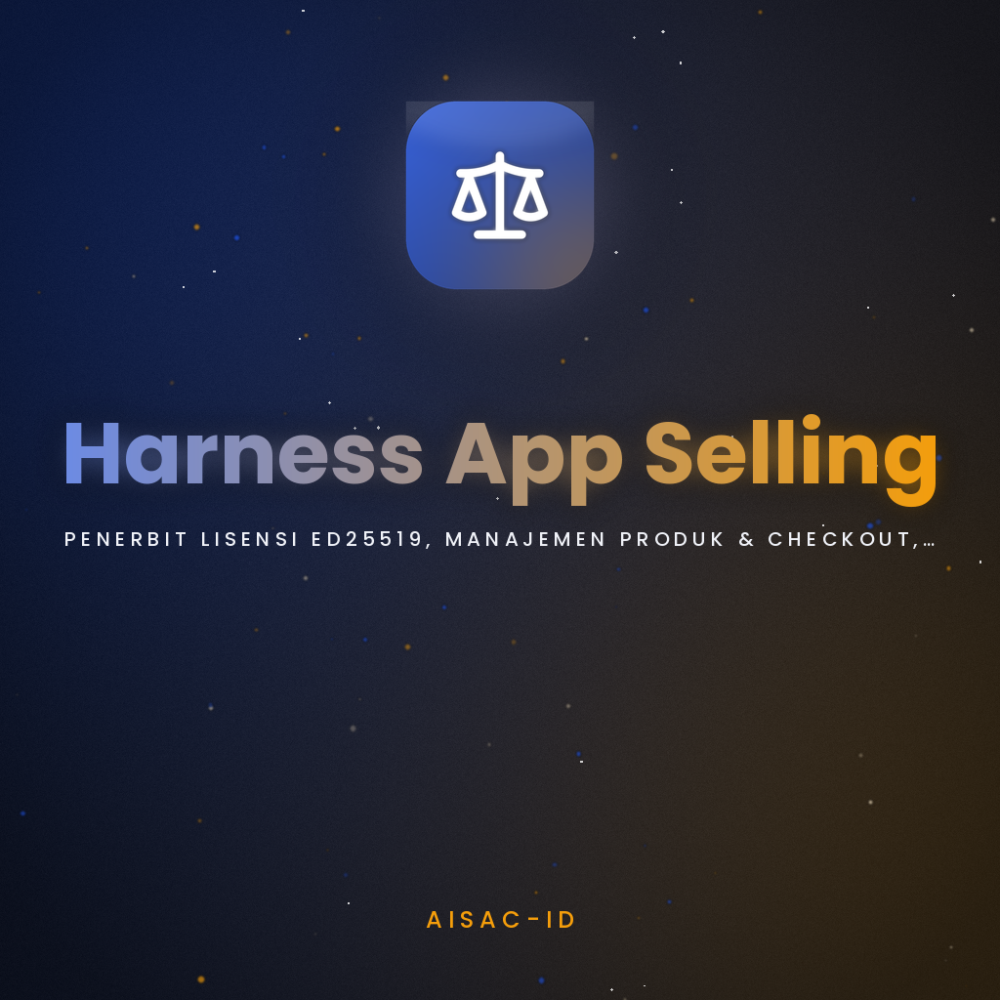

# Harness Selling Kit Factory

<p align="center">
  
</p>


Satu kali perintah, satu paket jualan lengkap. Factory ini membaca **satu `product.json`**
lalu menghasilkan seluruh aset penjualan sebuah produk digital: halaman landing, halaman
download pembeli, kunci lisensi Ed25519 asli, guidebook siap cetak, pack caption, prompt
pembuatan aset AI, contoh `.env`, `products.json`, email, checklist, README, dan `.gitignore`.

Ditulis untuk **Node.js >= 18** dan **hanya memakai modul bawaan** (`fs`, `path`, `crypto`,
`readline`). Tidak ada `npm install`, tidak ada dependensi pihak ketiga.

## Mulai cepat

```bash
node factory/cli.js examples/harness-extension/product.json out/harness-extension
```

Buka hasilnya:

```bash
xdg-open out/harness-extension/landing/index.html        # macOS: open
column -s, -t < out/harness-extension/license/keys.csv | head   # daftar kode lisensi
```

## Pilihan perintah

| Pilihan | Efek |
| --- | --- |
| `--keys=N` | jumlah kode lisensi yang diterbitkan (default: `license.count` di config, 5) |
| `--seats=N` | jumlah perangkat per kode |
| `--expiry=YYYY-MM-DD` | batas berlaku lisensi; tanpa pilihan ini = selamanya |
| `--new-keys` | paksa keypair Ed25519 baru (default: memakai `private_key.pem` yang sudah ada) |
| `--yes` | lewati konfirmasi saat menimpa private key |
| `--templates=DIR` | pakai folder template lain (untuk variant/gaya baru) |
| `--quiet` | ringkasan minimal |
| `--debug` | tampilkan stack trace saat error |

`--new-keys` sengaja ditanya dua kali: kode yang sudah terlanjur dikirim ke pembeli akan
berhenti lolos verifikasi bila private key-nya diganti.

## 12 komponen yang dihasilkan

Jalarkan factory, lalu `out/<slug>/` berisi:

| # | Berkas | Isi |
| --- | --- | --- |
| 1 | `landing/index.html` | Landing page jualan (hero, statistik, fitur, 3 langkah, harga 3 varian, isi bundel, sektor, FAQ) — statis, tanpa JavaScript, CSP ketat |
| 2 | `landing/download.html` | Halaman pembeli setelah bayar: isi paket, langkah aktivasi lisensi, install `load unpacked`, setup `.env`, support |
| 3 | `license/` | `public_key.pem`, `private_key.pem`, `keys.csv`, `keys.json` — kunci lisensi Ed25519 asli + verifikasi roundtrip |
| 4 | `guidebook/guidebook.html` | Buku panduan siap cetak ke PDF (bab instalasi, tutorial bernomor, multi-provider AI, resep otomasi per sektor, troubleshooting, halaman kode lisensi) |
| 5 | `captions/captions.md` | Pack caption multi-platform (Instagram, marketplace, email bundel, WhatsApp, hook video 15 detik, thread X) |
| 6 | `prompts/asset-prompts.md` | Prompt AI siap tempel untuk logo, box produk, banner, poster, square sosial, video promo — sudah memuat nama & palet produk |
| 7 | `env/.env.example` | Template `.env` dari daftar provider di `product.json` |
| 8 | `products.json` | Mesin produk: varian, harga, URL checkout, isi bundel |
| 9 | `emails/launch-email.md` + `emails/delivery-email.md` | Email peluncuran & email pengiriman otomatis (placeholder `license_key` / `download_link`) |
| 10 | `CHECKLIST.md` | Checklist peluncuran bernomor, termasuk semua tautan `GANTI` yang masih harus diisi |
| 11 | `README.md` | Panduan memakai kit ini + peringatan keamanan |
| 12 | `.gitignore` | Menolak `private_key.pem`, `keys.csv`, `.env` masuk repo publik |

## Struktur folder factory

```
harness-app-selling/
├── factory/
│   ├── cli.js                 entry & validasi pilihan
│   ├── KitGenerator.js        orkestrasi: tulis berkas, terbitkan lisensi, ringkas
│   ├── ProductConfig.js       baca + validasi schema product.json (pesan error jelas)
│   ├── LicenseIssuer.js       keypair Ed25519, terbit/verifikasi kode, keys.csv/json
│   ├── TemplateEngine.js      {{token}}, {{#each}}, {{#if}}, escaping HTML, mode ketat
│   ├── BaseGenerator.js       context bersama + turunan warna/CSS
│   ├── IconLibrary.js         18 ikon SVG inline
│   └── generators/            8 generator, masing-masing <= 300 baris
├── templates/                 7 template (landing, download, guidebook, captions, prompts, emails, checklist)
├── examples/harness-extension/product.json
├── out/                       hasil factory (di-gitignore)
├── AGENTS.md                  instruksi kerja untuk AI agent
└── package.json               hanya "type": "module" + engines, tanpa dependensi
```

## Produk baru

1. Salin `examples/harness-extension/product.json` ke `examples/<slug>/product.json`.
2. Ubah `name`, `slug`, `tagline`, `colors`, `features`, `steps`, `editions`, `bundleItems`,
   `sectors`, `faq`, `providers`, `guideSteps`, `guideSectors`, `license`, `brandRepoUrl`,
   `supportEmail`.
3. `node factory/cli.js examples/<slug>/product.json out/<slug>`
4. Bila config tidak valid, factory berhenti lebih dulu dengan pesan
   `[Konfigurasi produk tidak valid]` yang menyebut nama field-nya.

Warna landing/guidebook/download diturunkan otomatis dari 4 warna di `colors`
(`bg`, `accent`, `accent2`, `text`) — termasuk warna garis, kartu, dan efek glow.

## Keamanan kunci

- `license/private_key.pem` **tidak boleh** masuk repo publik, drive bersama, atau ZIP produk.
  Kit yang dihasilkan sudah memiliki `.gitignore` sendiri untuk menjaganya.
- Pembeli hanya butuh `public_key.pem` (atau verifikasi di sisi aplikasi) untuk mengecek kode.
- Format kode: `base64url(JSON payload).base64url(signature Ed25519)`.
  Payload memuat `edition`, `bundleId`, `seats`, `expiry`, `issuedTo`, `issuedAt`.
- Setiap kali menerbitkan kode, factory menandatangani lalu memverifikasi ulang seluruh baris;
  kalau ada satu yang gagal, proses berhenti dengan error (tidak ada kode cacat yang keluar).

## Batasan yang diketahui

- Semua tautan checkout, unduhan, gambar brand, dan nomor WA masih placeholder `GANTI`.
  `CHECKLIST.md` mendaftar satu per satu.
- Aset visual (logo, box, banner, video) tidak dihasilkan factory — gunakan
  `prompts/asset-prompts.md` lewat ImageGen/VideoGen, taruh di `out/<slug>/brand/`.
- Template landing memakai CSS sebaris dan font sistem supaya tetap tampil tanpa internet
  dan lolos CSP ketat; tidak ada skrip eksternal sama sekali.

---

## Brand & Promotion Kit

Aset branding resmi **Harness App Selling** — logo, software box, poster, banner, dan materi sosial.
Semua aset berada di folder [`promo/`](promo/) dan bebas dipakai untuk materi promosi proyek ini.

<p align="center">
  
</p>

| Aset | Pratinjau | Ukuran |
|---|---|---|
| Logo |  | 1024×1024 |
| Wordmark |  | 1600×500 |
| Software Box |  | 1600×1200 |
| Poster |  | 1200×1600 |
| Banner |  | 1920×820 |
| Social Preview |  | 1280×640 |
| Feature Showcase |  | 1600×1000 |
| Social Square |  | 1080×1080 |
